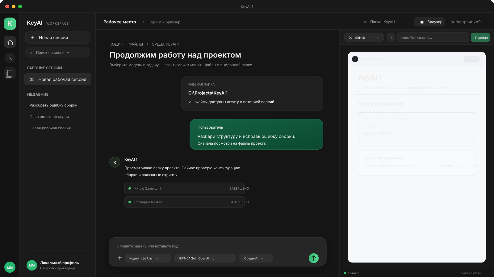

# KeyAI 1

Самостоятельный AI-workspace для Windows с тёмным интерфейсом, зелёными сообщениями пользователя, чатом, режимом сценариста, файловым coding-agent, терминалом и встроенным браузером на Servo через Verso. Это отдельный проект, а не копия Codex: закрытая архитектура, подписки и ключи OpenAI в него не входят.

> **Статус: experimental preview.** Браузерный движок Servo/Verso выбран вместо Chromium, но интеграция экспериментальная. Некоторые сайты могут отображаться неполно или не работать. Готовый EXE не включён в исходники: его собирает Windows GitHub Actions.

Это SVG-макет интерфейса, не снимок запущенного EXE. См. [примечание о скриншотах](docs/SCREENSHOTS.md).

## Возможности

- Три профиля: обычный чат, сценарист/редактор сериала и coding-agent.
- Каталог моделей запрашивается у выбранного провайдера. Поддерживаются OpenAI API, OpenRouter, Google AI Studio и локальный Ollama. OpenRouter показывает широкий каталог моделей разных компаний.
- Для OpenAI используется Responses API; для совместимых API — Chat Completions с вызовами инструментов.
- Ползунок рассуждений: низкий, средний, высокий. Применяется там, где выбранный провайдер и модель поддерживают этот параметр.
- Coding-agent может просматривать, читать, создавать и менять файлы только в выбранной рабочей папке. Перед заменой файл сохраняется; удаление перемещает файл в восстанавливаемую корзину KeyAI.
- Встроенный PowerShell-терминал. Каждая команда ждёт отдельного подтверждения Windows; запуск ограничен 30 секундами.
- Встроенные вкладки браузера на Servo/Verso принимают только HTTP(S). У удалённых сайтов нет командного моста KeyAI.
- API-ключи хранятся в Windows Credential Manager и не попадают в GitHub, исходники или EXE.

## Быстрая сборка Windows

На Windows x64 установите Rust через [rustup](https://www.rust-lang.org/tools/install) и Visual Studio Build Tools с компонентом **Desktop development with C++**. Затем запустите `BUILD-WINDOWS.cmd`. Он соберёт приложение и установщик NSIS и ZIP-архив с установщиком в `src-tauri\target\release\bundle\`.

Если Rust CLI Tauri ещё не установлен, скрипт предложит установить его через Cargo. Интернет нужен для загрузки Rust crates и официального предварительно собранного `versoview` для Servo/Verso.

Можно получить сборку без локальной установки: создайте пустой GitHub-репозиторий, загрузите сюда исходники и запустите workflow **Build Windows**. См. [инструкцию по сборке](docs/BUILDING.md).

## API и модели

Откройте **Настроить API**, сохраните собственный ключ и обновите список моделей. Ссылки на кабинеты провайдеров:

- [Ключ OpenAI API](https://platform.openai.com/api-keys)
- [Ключ OpenRouter](https://openrouter.ai/settings/keys)
- [Ключ Google AI Studio](https://aistudio.google.com/apikey)
- [Ollama для Windows](https://ollama.com/download/windows)

Подробности — в [каталоге моделей](docs/MODELS.md). API тарификация, доступность моделей и ограничения задаются провайдером отдельно. Приложение не снимает лимиты и не включает платный доступ. Локальные модели Ollama могут работать без облачного ключа, но требуют подходящего железа.

## Данные и безопасность

Выберите конкретную папку для coding-agent: её содержимое и запросы отправляются выбранному API-провайдеру. Файловые инструменты не запускают shell. Читайте [политику безопасности](SECURITY.md) и [архитектуру](docs/ARCHITECTURE.md) перед использованием на важных проектах.

Память в настройках — это сохранённые локально заметки, которые добавляются к запросам; она не переобучает модель. Приложение не содержит собственной обученной LLM.

## Репозиторий

Исходный код распространяется по лицензии Apache-2.0 (см. файл LICENSE). Servo/Verso, Tauri и остальные сторонние компоненты сохраняют собственные лицензии; исходные проекты перечислены в [NOTICE.md](NOTICE.md).
