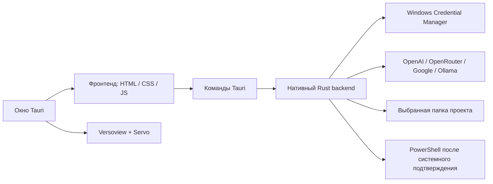

# Архитектура KeyAI 1

## Компоненты

- `frontend/index.html` и `frontend/app.js` содержат интерфейс: список сессий, три профиля, composer, каталог моделей, усилие рассуждения, терминал и панель браузера.
- `src-tauri/src/main.rs` реализует нативный IPC, провайдеры API, файловые функции coding-agent, историю версий, подтверждаемый PowerShell и дочерние browser webviews.
- `src-tauri/tauri.conf.json` задаёт окно, CSP, разрешения и включение sidecar `versoview` в Windows-установщик.
- `src-tauri/build.rs` загружает заранее собранный `versoview` из официального runtime build helper. Компиляция самого браузерного движка вручную не выполняется.

## Поток coding-agent

1. Пользователь выбирает рабочую папку.
2. Интерфейс отправляет историю и инструкцию профиля выбранному API.
3. Модель может запросить ограниченный файловый инструмент: список, чтение, создание/замена, перенос файла в корзину, просмотр версий или восстановление.
4. Backend проверяет относительный путь, границы папки и размер. Перед заменой сохраняется резервная копия; действия записываются в `agent-actions.jsonl`.
5. Результат возвращается модели, после чего она формирует ответ.

OpenAI используется через Responses API. Остальные выбранные API вызываются через совместимый Chat Completions endpoint.

## Границы безопасности

Файловые инструменты не исполняют команды. Терминал требует отдельного системного подтверждения перед каждым запуском PowerShell; есть ограничение времени и размера вывода. Встроенный браузер создаёт отдельные webviews без разрешения `main` и не получает команд IPC KeyAI; разрешены только HTTP и HTTPS.

Выбранные запросы, содержимое файлов и результаты передаются провайдеру модели. Ключи и история версий хранятся локально.
